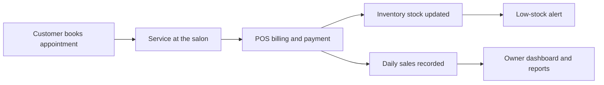

# Run your salon smarter.

### Salon billing software that manages inventory, POS billing, customers, bookings and everyday sales, in one place.

---

## Your entire salon, in one platform

Billboook is a salon billing and management platform built to help owners spend less time on paperwork and more time with their clients. From the front desk to the back office, it brings every part of a salon into one fast, reliable system.

Whether you run a single-chair studio or a multi-branch chain, Billboook scales with your business.

---

## How Billboook works

From booking to reporting, every step feeds the next, so nothing is entered twice.

---

## Know your numbers at a glance

*Sample data, shown for illustration only.*

Daily sales, revenue by service, product, membership and package, and staff performance, all in real time.

---

## Everything you need to run the day

### Sell

| | |
|---|---|
| **Billing and invoicing** | Professional invoices with services, products, discounts, GST and multiple payment modes. |
| **Point of sale** | Fast, touch-friendly checkout with cash, UPI, card, wallet and split payments. |
| **Offers and loyalty** | Discounts, coupons, memberships and loyalty programs that bring clients back. |

### Serve

| | |
|---|---|
| **Appointments** | Scheduling by staff member, double-booking protection and automatic client reminders. |
| **Customers** | Profiles, visit history, preferences, loyalty points, memberships and packages. |
| **Staff management** | Attendance, commissions, incentives and service-wise performance. |

### Grow

| | |
|---|---|
| **Inventory** | Stock tracking, low-stock alerts, supplier management and consumption monitoring. |
| **Daily sales and reports** | Real-time revenue, expenses and staff performance, at a glance. |
| **Multi-branch** | Manage every outlet from a single dashboard. |

---

## Why salons choose Billboook

| | |
|---|---|
| **Fast** | Bill a customer in seconds, not minutes. |
| **Simple** | Built for salon teams, with no training manual required. |
| **Insightful** | Know exactly how your business is doing, every day. |
| **Secure** | Business and customer data stays protected and backed up. |
| **Accessible** | Works on desktop, tablet and mobile. |

---

## Get started

Ready to simplify your salon?

Questions? Reach us at **support@billboook.in**

